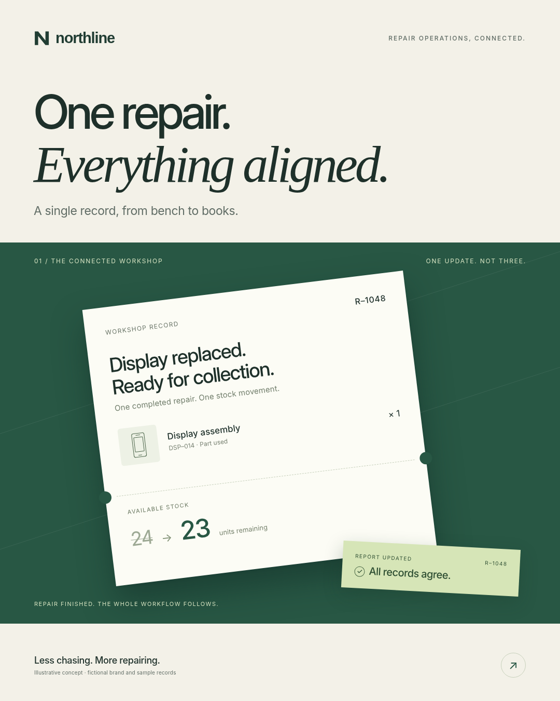

# Co-founder: Claude Code and Codex skills for solo founders

**Know the project. Challenge the idea. Build with evidence. Keep the brand connected.**

Co-founder is an open-source pack of **Claude Code skills for solo founders** that
also installs as a **Codex co-founder skill**. It works inside your existing Codex or
Claude Code session: one entry skill, 13 focused workflows, private project
knowledge, local verification helpers and project-bound creative production.

The same `SKILL.md` files serve as Claude co-founder skills in Claude Code and as
Codex skills for founders in Codex CLI/IDE. There is no separate build per host.

No hosted service, mandatory model API, credential scraping, pack telemetry or automatic
agent team. Your host still uses its normal subscription allowance. This is a
working method, not a new model or an autonomous legal/business partner.

## What's different in 1.1

**Project identity comes first.** An explicit project manifest selects the correct
business and product/personal brand. UI, websites, posts and video can use distinct
surface rules while sharing the project's actual approved assets. Stale asset
hashes, mismatched project IDs and ambiguous multi-project roots are rejected by
the context helper. These are local integrity checks, not authentication.

**Creative work is not a universal layout.** The new process separates product UI,
marketing websites, campaign concepts and motion storytelling. It requires an
actual reference inspection, a suitable concept, rendered review and specific
revision. The old headline-and-diagram renderer is retained only as a legacy
compatibility/smoke helper, not a design default.

**All 13 workflows have review principles.** Project scope, evidence and truthful
handoff apply everywhere, with specialist-specific criteria. A structural review
can say blocked, inconclusive or ready for human review. It cannot certify taste,
security or approval to publish.

## Install the skills in Claude Code or Codex

Install from GitHub with the third-party `skills` CLI:

```sh
npx skills add jpmishra1010/co-founder-skills --skill co-founder
```

The interactive installer lets you choose the agent and installation scope. To
select both supported hosts and user scope explicitly:

```sh
npx skills add jpmishra1010/co-founder-skills --skill co-founder --agent codex claude-code --global
```

**From a local copy** (an extracted ZIP or a clone), open its `co-founder` folder and
install from the local skill directory:

```sh
npx skills add ./skills/co-founder --agent codex claude-code --global
```

`npx` runs the third-party `skills` CLI; Co-founder does not need its own npm
publication or a `package.json`. Node.js/npm and access to the CLI (network or cache)
are needed for this route. Python is not executed to install these skill files.
**Python 3.10+ is still required to run Co-founder's project-binding, validation and
other Python helpers.** Browser/video tools remain separate optional dependencies.
Do not silently omit mandatory checks when a runtime is missing.

The main `co-founder` skill includes all 13 workflows. Specialist entries are optional
shortcuts that depend on the main skill; they are not standalone packages. No model
team or paid API is started by installation.

The skills CLI is independently maintained and has its own update, overwrite and
telemetry behavior. Review prompts; use `DISABLE_TELEMETRY=1` for its documented
telemetry opt-out. Co-founder itself contains no telemetry. See
[installation and migration](docs/INSTALLATION.md), especially before switching
from the older Python-managed installation. Do not mix installation managers.

The Python installer remains an [offline fallback](docs/INSTALLATION.md#offline-python-fallback).
This patch changes distribution docs and license packaging, not the creative work.

Open **your actual product**, not this repository, in the host. Invoke `$co-founder`
in Codex CLI/IDE, `/co-founder` in Claude Code, or the host's skill picker. Start:

> Understand this project in read-only mode. Establish its identity, existing design
> tokens and asset candidates. Do not edit code or install tools. Show me the proposed
> project/brand binding and any conflicts before creating or approving context.

[Start here](START_HERE.md) · [Installation](docs/INSTALLATION.md) ·
[Project setup](docs/PROJECT_CONTEXT.md) · [Host acceptance](docs/ACCEPTANCE.md)

## Connected examples—not defaults for your brand

The fictional **Northline** example connects a repair workflow, one campaign concept
and an editable motion sequence through the same logo, typography and green/neutral
palette. **Fieldnote** is a contrasting brand-isolation fixture. Neither is a real
customer product, and neither is auto-applied to another project.

[Working UI](examples/connected-brand/previews/ui.html) ·
[Campaign post](examples/connected-brand/previews/post.png) ·
[24-second silent motion sample](examples/connected-brand/previews/motion.mp4) ·
[Editable sources and review](examples/connected-brand/README.md)



## Thirteen founder workflows, one conversation

| Workflow | Responsibility |
|---|---|
| `decide` | Research and challenge assumptions; compare the current state and smaller alternatives. |
| `feature-plan` | Define users, states, recovery, permissions and observable acceptance criteria. |
| `impact-map` | Trace shared data/modules and the behavior a change must preserve. |
| `build-fix` | Reproduce, diagnose and implement authorized bounded changes. |
| `verify-release` | Execute relevant checks; expose changed tests and distinguish release states. |
| `security-review` | Review actual trust boundaries, deny paths and sensitive business operations. |
| `ui-polish` | Improve an existing product or website using its own design language and real states. |
| `customer-care` | Follow an issue through reproduction, verification, deployment and customer outcome. |
| `growth` | Choose a measurable experiment around the actual acquisition/activation bottleneck. |
| `sales` | Prepare relevant demos and truthful proposals/follow-ups using approved terms. |
| `finance` | Track cash, runway, pricing and revenue from sourced records; prepare accountant questions. |
| `content-studio` | Produce project-specific posts, campaigns and motion with actual craft review. |
| `founder-brief` | Surface a small useful set of priorities using fresh, authorized evidence. |

[Audit of every workflow](docs/SKILL_AUDIT.md)

## Privacy, approvals and cost

Private `.co-founder/` context belongs inside each actual product repository, not
inside the public pack. Only the two deliberately synthetic example manifests are
included here. Do not add real customer records, secrets, font binaries or copied
reference artwork. A skill is not a security boundary: use host sandbox/permission
controls and protected review for consequential actions.

One workflow is loaded at a time. General work does not load brand media. Bundles
contain selected asset paths/hashes, not every image's bytes. Scoped checks and
bounded retries help avoid waste; no percentage token-saving claim is made.
Publishing, sending, deployment, spending and scheduling remain separately authorized.

[Security](SECURITY.md) · [Token discipline](docs/TOKEN_DISCIPLINE.md) ·
[Privacy](docs/PRIVACY_AND_SECURITY.md)

## Validate and publish

```sh
python scripts/validate.py
python -m unittest discover -s tests -v
```

Optional browser/media checks require explicit local dependencies. See
[media production](docs/MEDIA.md) and the [actual validation report](docs/VALIDATION.md).
Model behavior inside authenticated Codex/Claude sessions has not been tested here.
Reference-film full playback and broad social-feed audits remain unverified; the
[research record](docs/RESEARCH.md) distinguishes access modes honestly.

[Contribute](CONTRIBUTING.md) · [Publish on GitHub](docs/PUBLISHING.md) ·
[Changelog](CHANGELOG.md)

## License

Original pack code, prose and fictional artwork: [MIT](LICENSE). External tools,
trademarks and references retain their own rights. No external films, campaign
artwork or font files are bundled. Not affiliated with OpenAI or Anthropic. No
perfect-design, security, revenue, virality, search-ranking or usage-saving guarantee.
